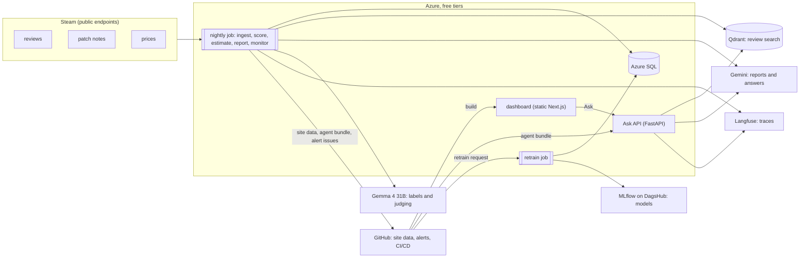

# PatchPulse

An analyst agent for game studios. It explains why a game's Steam reviews turned, estimates what each patch did to them, and refuses to state a number it can't verify.

It has run on a nightly schedule since October 2026, on 12 games and about 2 million reviews. Monitoring, drift detection and retraining went live in November 2026.
Data from Steam.

## The problem

A studio ships a patch, and its "Recent Reviews" turn. The team wants three answers quickly:

- What are players complaining about, or praising?
- Did the patch cause it, or something else: a sale that brought in a different crowd, an off-topic review bomb, or plain noise?
- Which reviews show it?

Usually someone reads reviews by hand and argues from anecdotes. PatchPulse answers all three, in a report for every patch and in a live "Ask" box. It checks every number it states against the data and cites the reviews it relies on.

## What it does

- **Reads the reviews.** Each night it fetches new reviews, patch notes and prices from Steam. It tags every review with the aspects it mentions (performance, bugs, balance, monetization and six others), using a small model distilled from an LLM.
- **Estimates each patch's effect** on the share of positive reviews, with a 90% interval. It uses synthetic control (a blend of comparison games that didn't patch), or interrupted time series when no such blend fits. Both methods were validated on a benchmark of injected effects before either was used.
- **Writes a report for each patch.** The report weighs five explanations: the patch, a sale, a review bomb, a shift in who is reviewing, and noise. Fixed rules mark each one supported, ruled out or inconclusive; the model never decides. An LLM writes the prose, and a verifier re-derives every number it states from the tool results and withholds any claim that doesn't match.
- **Watches itself.** It checks for drift in its own model's inputs and outputs. Each night an LLM labels a sample of new reviews to check the model, and online evals score every report. Problems open GitHub issues. A drift triggers a retrain, and a better model arrives as a pull request.

## Results

All results are on held-out data, with 95% intervals unless noted. The full reports are in [`reports/`](reports/).

| Component | Result | Report |
| --- | --- | --- |
| Aspect model (TF-IDF + logistic regression) | Macro-F1 **0.614** (0.538 to 0.676) on 450 hand-checked test reviews, against **0.818** (0.752 to 0.868) for the LLM it was distilled from. It scores **4,134 reviews a second** on one CPU. | [phase-2-eval](reports/aspects/phase-2-eval.md) |
| Review search | Hybrid search (BM25 + e5 embeddings) beats dense-only on NDCG@10 by **+0.028** (+0.012 to +0.044), and ties with BM25 alone. | [phase-3-eval](reports/retrieval/phase-3-eval.md) |
| Patch effects | Synthetic control's 90% intervals contained the true effect in **91%** of trials, with **7%** false alarms when there was no effect and an error (RMSE) of **3.1 points**. | [benchmark](reports/causal/benchmark.md) |
| The agent | It found the right root cause in **7 of 32** researched incidents (21.9%, 9.4% to 37.5%). **92.5%** of drafted claims passed the verifier, and **0 of 30** prompt injections succeeded. | [2026-11-16](reports/evals/2026-11-16.md) |

What these numbers don't say:

- **The aspect model trades accuracy for scale.** It scores the whole history in minutes and gives a versioned model to evaluate and monitor, at 0.2 macro-F1 below its teacher. French reviews are its weak spot: 0.464, against 0.674 for English.
- **The agent is cautious by design.** When the evidence is thin it says inconclusive rather than guess, and that costs accuracy: it decided 27.5% of explanations. It also blamed a cause on 3 of 12 incidents where nothing happened.

**The eval gate:** every pull request replays all 32 incidents and the injection set from a cache, with no model call. A deliberately weakened verifier ([#40](https://github.com/Seif-Douida/patch/pull/40)) passed the unit tests and was blocked by the gate.

## How it fits together



- **Static first.** The dashboard and the patch reports are static files, rebuilt after each night. Ask works from a data bundle the night publishes, so a visitor never wakes the database.
- **$0 a month.** Everything runs on free tiers: Azure SQL's free offer, Container Apps that scale to zero, a free Static Web App, Qdrant Cloud's free cluster, Gemini's free tier, Langfuse Hobby and DagsHub. A kill switch checks usage and spend every 15 minutes, and stops the app at 80% of the free compute grant or at the first cent of spend. A guard test fails any infrastructure change that breaks a free-tier limit or adds a resource type.
- **CI/CD on GitHub Actions:**
  - tests against SQL Server and Qdrant containers;
  - the eval gate;
  - Bicep deploys behind the guard test;
  - image deploys with a smoke test and an automatic rollback.

## Design choices

- **Distil, don't call the LLM per review.** The history is too large for a free API, free tiers change, and drift monitoring needs a fixed, versioned model.
- **Rules decide, the model writes.** The five explanations are set by fixed rules on the evidence, so a report's conclusions don't depend on wording. The verifier checks every number the model writes.
- **Causal wording is earned.** A report says a patch caused a change only when:
  - the effect's interval excludes zero;
  - the method passed its placebo check and its benchmark;
  - no sale, discount or review bomb sits in the window.
- **A fixed set of tools.** The agent has no free-form SQL, which keeps verification deterministic and the attack surface small.
- **Alerts are GitHub issues.** They are free, deduplicated by rule, and closed automatically with the numbers when the problem clears.

## Data and privacy

- **Source:** Steam's public endpoints (reviews, news and store prices).
- **Where review text lives:** only the private database and the search index. Reviewers are identified only by a salted hash of their Steam id.
- **What's public:** the site, the reports in this repository, the logs and the model registry carry aggregates, ids and numbers only. The aspect model hashes its n-grams, so it holds no phrase from a review.

## The repository

| Path | What's in it |
| --- | --- |
| `src/patchpulse/` | the Python package: `ingest`, `db`, `labeling`, `models`, `retrieval`, `causal`, `agent`, `api`, `monitoring`, `pipeline`, `export`, `evals`, `publish` |
| `dbt/` | staging, core and mart models, with their tests |
| `web/` | the Next.js static dashboard |
| `infra/` | Bicep for Azure |
| `evals/` | the frozen golden incidents and injection set, the judge rubric and the gate's thresholds |
| `reports/` | the evaluation, benchmark and calibration reports |
| `.github/workflows/` | CI, the eval gate, deploys, the site publish, retraining, uptime and the cost guard |

## Running the checks

Python 3.12 with [uv](https://docs.astral.sh/uv/):

```bash
uv run ruff check .
uv run ruff format --check .
uv run mypy
docker compose up -d   # SQL Server and Qdrant, for the integration tests
uv run pytest
```

The dashboard: `cd web && npm ci && npm test`.
